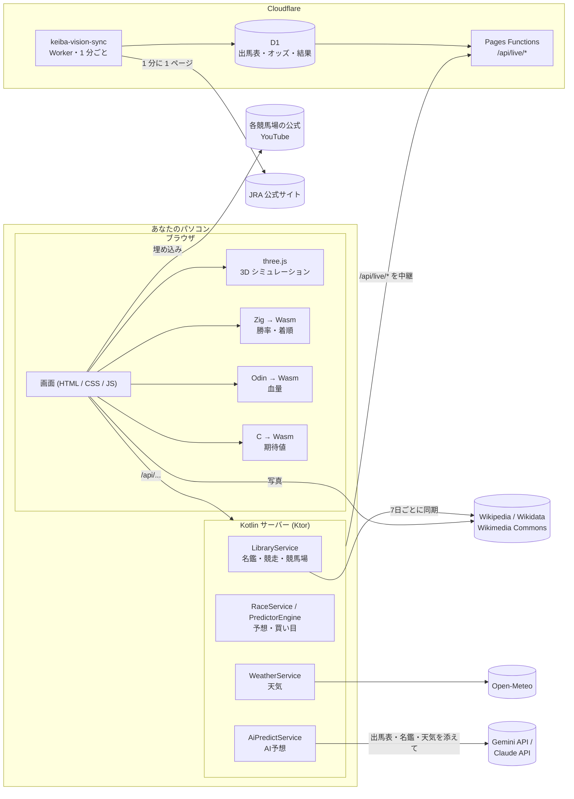

# Keiba Vision

**JRA の今週の全レースを自動で取り込んで予想する** 競馬アプリです。出馬表とオッズは人の操作なしで更新され、予想の理由・買い方の比較・過去のレースでの答え合わせまで見られます。
ほかに、全国25の競馬場、5,800頭を超える競走馬の名鑑、仮想のお金で馬券を買える 3D のレースシミュレーション、競馬のルールを学べるチュートリアル、各競馬場の公式中継をひとつにまとめています。
本体は **Kotlin** で、重い計算の一部を **Zig・Odin・C** で書いて **WebAssembly** に変換し、ブラウザの中で動かしています。Web 版は **Cloudflare Pages** (Functions・D1・R2・Workers) で動いています。

**Web 版 (インストール不要): https://keiba-vision.pages.dev**

**ドキュメント (予想と推論の数学を、初心者から専門家レベルまで): https://keiba-vision-docs.pages.dev**


> [!NOTE]
> 予想とシミュレーションは娯楽・学習のためのものです。馬券の購入は20歳以上、無理のない範囲で楽しみましょう。

---

## できること

| 画面 | 内容 |
|---|---|
| ホーム | 全国25場の **今の天気と推定の馬場状態**、登録データの件数、名馬のピックアップ |
| はじめての競馬 | 競馬の仕組み・レースの格・馬場・出馬表の読み方・脚質・馬券の種類・オッズを、図と確認クイズで学べるチュートリアル |
| レース予想 | **JRA の今週の全レース** を自動で取り込み、出馬表・オッズ・印、**予想の見解** (推す理由と危険な人気馬)、**買い方の比較** (7 通りの的中率と回収率)、同じレースを **10万回走らせた勝率**。これからの開催 (10週間) の予定表も |
| 予想の成績 | 過去のレースを同じモデルで予想し直し、実際の着順・払戻金と答え合わせ (的中率・回収率・対数損失、累積収支のグラフ) |
| AI予想 | **Gemini と Claude** にレースを予想させ、2つの勝率を平均した **総合予想**。JRA の今週の出馬表 (オッズ・近走つき) を選ぶだけで AI に渡せる。名鑑にいる馬は戦績・血統・能力値も渡す。予想した馬をそのまま 3D で走らせられ、履歴と的中率の集計つき |
| 3D シミュレーション | 好きな競馬場・距離・馬場で、名鑑の馬を最大18頭選んで **3Dで走らせる**。中継・追走・俯瞰・自由視点の4カメラ、等速/2倍/4倍、着差 (ハナ・クビ・1 1/4 …) つきの結果表。スタート前に **仮想のお金で馬券を買う予想ゲーム** (7 券種) |
| 中継 | 各競馬場の **公式 YouTube チャンネル** を埋め込み再生 (ライブ / 最新の映像) |
| 競馬場 | 中央10場・地方14場・ばんえい1場。写真、コース図、直線の長さ、回り、現在の天気、その場で行われる主な競走 |
| 競走一覧 | 国内の **726競走** を格付け (GI〜GIII・JpnI〜III ほか)・競馬場・芝/ダートで絞り込み |
| 競走馬名鑑 | **5,861頭** (うち写真付き 3,146頭)。名前・父・母・勝ち鞍で検索、能力値・重賞勝利数・年代で並び替え。詳細画面に写真 (作者とライセンス表示つき)、血統、成績、獲得賞金、主な勝ち鞍、Wikipedia の要約 |
| 血統 | 主な父系の系統図と、**血量・近交係数の計算機** (3×4 = 18.75% など) |
| 品種と毛色 | 品種ごとの体高くらべ、JRA の8つの毛色の図 |
| 払戻計算 | オッズと金額から払戻金と回収率 |
| 設定 | ライト / ダーク / 自動、データの更新、計算エンジンの状態、データとライセンスの一覧 |

| 3D シミュレーション (昼) | 3D シミュレーション (ナイター) |
|---|---|
|  |  |

| 結果と着差 | 競走馬名鑑 |
|---|---|
|  |  |

| 馬の詳細 (ダーク) | 競馬場の詳細 |
|---|---|
|  |  |

| レース予想 (開催前は次の開催と予定表) | 予想ゲーム (3D) |
|---|---|
|  |  |

| はじめての競馬 (図と確認クイズ) | 中継 |
|---|---|
|  |  |

| 起動画面 (発馬ゲートが開いて本編へ) | ホーム (ダーク) | スマホ |
|---|---|---|
|  |  |  |

---

## 目次

1. [まず動かす (いちばん簡単な方法)](#まず動かす-いちばん簡単な方法)
2. [Java を入れる (OS 別)](#java-を入れる-os-別)
3. [ソースコードから動かす](#ソースコードから動かす)
4. [画面ごとの使い方](#画面ごとの使い方)
5. [データはどこから来ているか](#データはどこから来ているか)
6. [用語集](#用語集)
7. [しくみ](#しくみ)
8. [フォルダ構成](#フォルダ構成)
9. [API 一覧](#api-一覧)
10. [Zig / Odin / C を自分でビルドする](#zig--odin--c-を自分でビルドする)
11. [改造してみる](#改造してみる)
12. [ドキュメントサイト](#ドキュメントサイト)
13. [Web 版 (Cloudflare Pages)](#web-版-cloudflare-pages)
14. [GitHub Actions](#github-actions)
15. [困ったときは](#困ったときは)
16. [できないこと・既知の制限](#できないこと既知の制限)
17. [ライセンスとクレジット](#ライセンスとクレジット)

---

## まず動かす (いちばん簡単な方法)

1. **Java 21 を入れる** ([次の章](#java-を入れる-os-別)。17 以上が入っていればそのままでも動きます)
2. このリポジトリの右側にある **Releases** を開き、いちばん新しい版の **`keiba-predictor.zip`** をダウンロード
3. zip を展開 (Windows は右クリック →「すべて展開」、Mac はダブルクリック)
4. 展開したフォルダの中の **`bin`** を開いて起動
   - **Windows**: `keiba-predictor.bat` をダブルクリック
   - **Mac / Linux**: ターミナルで `./bin/keiba-predictor`
5. 数秒でブラウザが開きます。開かないときはアドレス欄に **`http://localhost:8080`** と入力

**終わり方**: 起動した黒い画面 (ターミナル) を閉じるか、その画面で `Ctrl` + `C`。

> [!TIP]
> `localhost` は「自分のパソコン」という意味です。アプリは自分のパソコンの中で小さなサーバーとして動き、ブラウザがそこに接続します。外部に公開されることはありません。

**インターネット接続について**: 名鑑・競走・競馬場のデータはアプリに同梱されているので、オフラインでも見られます。天気・写真・中継・Wikipedia の要約、それに **レース予想 (JRA の今週のレース)・予想の成績** はインターネットが必要です。オフラインのときのレース予想は、内蔵のサンプル出馬表 (3 レース) になります。

---

## Java を入れる (OS 別)

このアプリは Kotlin で書かれていて、**Java 21 以上** の上で動きます。

### 入っているか確認

ターミナル (Windows は「コマンドプロンプト」か「PowerShell」) で次を入力して Enter:

```sh
java -version
```

`openjdk version "21.x.x"` のように **21 以上** が出れば準備完了です。`java は認識されていません` や `command not found` が出たら、以下で入れます。

<details>
<summary><b>Windows</b></summary>

1. <https://adoptium.net/ja/> を開く
2. 「Temurin 21 (LTS)」の Windows 用 `.msi` をダウンロード
3. インストール中の画面で **「Set JAVA_HOME variable」「Add to PATH」を有効** にする
4. コマンドプロンプトを **開き直して** `java -version` で確認

PowerShell なら `winget install EclipseAdoptium.Temurin.21.JDK` でも入ります。
</details>

<details>
<summary><b>macOS</b></summary>

[Homebrew](https://brew.sh/ja/) があれば `brew install --cask temurin@21`。
なければ <https://adoptium.net/ja/> から macOS 用の `.pkg` を入れます。
</details>

<details>
<summary><b>Linux</b></summary>

```sh
sudo apt install openjdk-21-jdk     # Ubuntu / Debian
sudo pacman -S jdk21-openjdk        # Arch Linux
sudo dnf install java-21-openjdk    # Fedora
doas apk add openjdk21              # Chimera Linux (musl)
```
</details>

---

## ソースコードから動かす

### 1. ダウンロード

```sh
git clone https://github.com/TatsuyaM2667/keiba-predictor.git
cd keiba-predictor
```

Git がなければ、GitHub のページ上部の緑のボタン **`<> Code` → `Download ZIP`** で落として展開し、そのフォルダでターミナルを開きます。

> [!TIP]
> **フォルダでターミナルを開く方法**
> - Windows: エクスプローラーのアドレス欄に `cmd` と入力して Enter
> - Mac: Finder でフォルダを右クリック →「フォルダに新規ターミナル」
> - Linux: ファイルマネージャーで右クリック →「端末で開く」

### 2. 起動

| OS | コマンド |
|---|---|
| Windows | `run.bat` をダブルクリック (または `gradlew.bat run`) |
| Mac / Linux | `./run.sh` (または `./gradlew run`) |

**初回だけ 1〜3 分** かかります (ビルド道具の Gradle とライブラリを自動でダウンロードするため)。2回目からは数秒です。

### 3. 便利な設定 (環境変数)

| 変数 | 意味 | 例 |
|---|---|---|
| `PORT` | 使うポート番号 (8080 が使用中のとき) | `PORT=9000 ./gradlew run` |
| `NO_BROWSER` | ブラウザを自動で開かない | `NO_BROWSER=1 ./gradlew run` |
| `HOST` | 待ち受けるアドレス。既定は `127.0.0.1` (このパソコンからだけ)。同じ Wi-Fi のスマホから見たいときは `0.0.0.0` (AI予想はこのパソコンからだけ使えます) | `HOST=0.0.0.0 ./gradlew run` |
| `GEMINI_API_KEY` / `ANTHROPIC_API_KEY` | AI予想の API キー (画面の「APIキーとモデル」で保存したキーが優先) | `GEMINI_API_KEY=... ./gradlew run` |

Windows のコマンドプロンプトでは `set PORT=9000` と `gradlew.bat run` を2行に分けて入力します。

---

## 画面ごとの使い方

左のメニュー (スマホでは上の横スクロールメニュー) で画面を切り替えます。URL は `http://localhost:8080/#/horses` のように画面ごとに変わるので、ブックマークもできます。

### 起動画面
8つの枠の発馬ゲートが並び、読み込みが終わるとゲートが開いて本編に切り替わります。右下の「スキップ」か `Esc` キーで飛ばせます。OS で「視差効果を減らす / アニメーションを減らす」を有効にしている場合は、動きを最小限にします。

### ライト / ダーク
左下のスイッチで切り替えます。設定画面で「自動」を選ぶと OS の設定に合わせます。3D シミュレーションはダークのとき **ナイター** (夜の照明) で描かれます。

### ホーム
全国25場の現在の天気 ([Open-Meteo](https://open-meteo.com/)) と、降水量から推定した馬場状態 (良・稍重・重・不良) を表示します。カードを押すとその競馬場の詳細が開きます。推定馬場は公式発表ではありません。

### はじめての競馬
競馬をまったく知らない人向けのチュートリアルです。左の目次から章を選びます。

| 章 | 内容 |
|---|---|
| 1. 競馬ってなに? | 中央競馬 (JRA) と地方競馬、1 つのレースの流れ |
| 2. レースの格とクラス | 新馬 → 未勝利 → 1〜3勝クラス → オープン → GIII・GII・GI、三冠、斤量の決め方 |
| 3. コースと馬場 | 芝とダート、右回り・左回り、距離、馬場状態 (良〜不良)、枠 |
| 4. 出馬表の読み方 | 1 行の各欄 (枠・馬番・性齢・斤量・騎手・馬体重・オッズ) を図で説明 |
| 5. 脚質と展開 | 逃げ・先行・差し・追込の位置取り図、ペースと有利不利 |
| 6. 馬券の種類 | 単勝〜3連単の「どの着順を当てるか」の図と控除率、流し・ボックス・フォーメーション |
| 7. オッズと払戻のしくみ | 売上 → 控除 → 払戻 の図、期待値 |
| 8. 予想の考え方とアプリの使い方 | 予想で見るポイントと、このアプリの各画面への案内 |
| 9. 楽しむときの約束 | 20 歳以上、予算を決める、控除率があるので平均すると損をすること |

各章の最後の **確認クイズ** に答えると、その場で正解と解説が出ます。全問正解した章には完了の印が付きます (このブラウザに記録)。

### レース予想
JRA (中央競馬) の今週のレースを、**人の操作なしで自動で** 表示します。上で開催日 → 競馬場 → 1R〜12R を選びます。

- 出馬表とオッズは JRA 公式サイトから自動で取り込み (当日の発走前は 20 分ごと)、画面は開いている間 2 分ごとに読み直します。新しい開催やレースが発表されると、選択肢も自動で増えます
- 出馬表がまだ発表されていない日 (月〜木曜など) は、次の開催日と重賞を表示します。発表されると自動で予想の画面に切り替わります
- 下の **これからの開催** に、10 週間先までの開催場と重賞を並べています。出馬表がある日を押すと、その日のレースが開きます
- JRA のデータを取得できない環境 (オフラインのローカル版など) では、内蔵のサンプル出馬表 (有馬記念・日本ダービー・ジャパンカップ) になります

画面の上から順に:

| 欄 | 内容 |
|---|---|
| レースの見出し | 格・競馬場・距離・回り・発走時刻、出走頭数、想定ペース、データの時刻 (出典: JRA 公式サイト)、現地の天気 |
| **予想の見解** | ◎◯▲△ の馬ごとに、推す理由 (近 4 走の評価と順位・前走・距離と馬場の経験・展開との相性・オッズとの比較) を文章で表示。人気なのに予想勝率が市場の 7 割に届かない馬は **危険な人気馬** として注意 |
| **買い方の比較** | 単勝 ◎ / 複勝 ◎ / ワイド ◎-◯ / 馬連 ◎→◯▲△ / 馬単 ◎→◯▲△ / 3連複 ◎◯▲△ ボックス / 3連単 ◎ 1 着固定 の 7 通りについて、点数・買い目・的中率・回収率。回収率が 100% を超えるものがあれば **おすすめ**、なければ **見送り** を表示 |
| 勝率シミュレーション | 同じレースを 10 万回走らせて 1 着になった割合 (濃い棒) と 3 着以内の割合 (淡い棒)。右上でペースを変えると、逃げ・先行と差し・追込の有利不利が変わります |
| 買い目と配分 | 勝率 × オッズ (期待値) が 1 を超える馬の単勝だけを、ケリー基準の 1/4 で配分。該当がなければ「見送り」 |
| 出馬表 | 馬番・評価・人気・妙味で並び替え。☆でお気に入り (要サインイン) |
| このレースを3Dで見る | 出走馬 (毛色も) をそのまま 3D シミュレーションに送ります |

**予想のしかた**: 各馬の過去 4 走 (着順・頭数・格・勝ち馬とのタイム差) から「平均的な出来」を、1 コーナーの通過順位から脚質を推定し、逃げ・先行の頭数からペースを予想します。それを Zig のプログラムで 10 万回走らせて勝率を出し、単勝オッズ (市場の予想) と比べます。単勝以外のオッズは取り込んでいないので、買い方の比較では単勝オッズから推定したオッズ (Harville の公式、画面では * 印) を使います。式と計算例は [ドキュメント「実際のレースの予想」](https://keiba-vision-docs.pages.dev/learn/live) にあります。

### 予想の成績
JRA の過去のレース (最近の重賞と、直近の開催の全レース) を、レース予想と **同じ計算** で **レース前の情報だけ** (確定オッズと、そのときの過去 4 走) から予想し直し、実際の着順・払戻金と答え合わせします。データは自動で集めるので、週を追うごとに増えていきます。

- **◎ の勝率・3 着以内率** を、1 番人気と比べる
- **予想の精度 (対数損失)** を、市場 (オッズ) と比べる。小さいほど正確で、市場より小さければ市場より正確
- **買い方ごとの成績**: 上の 7 通り + アプリの買い目 + 1 番人気の単勝 (比較用) の、的中率・投資・払戻・回収率。払戻は JRA の実際の払戻金
- **累積収支のグラフ**: ◎ の単勝・アプリの買い目・1 番人気の単勝を、1 レース 100 円ずつ続けた場合
- **レースごとの答え合わせ**: ◎ と ◯ と 1 番人気が何着だったか、勝ち馬、単勝配当、収支。「重賞」「◎ が 3 着以内」で絞り込み

> [!NOTE]
> レース数が少ないうちは、1 回の大穴で回収率が大きくぶれます (例: 16 番人気の単勝 7,420 円が 1 回当たるだけで回収率 1,000% 超)。数十レースでは回収率はほとんど当てにならないので、まずは対数損失を見てください。理由は [ドキュメント「予想の成績」](https://keiba-vision-docs.pages.dev/learn/backtest) に式で説明しています。

### AI予想
Google の **Gemini** と Anthropic の **Claude** に同じレースを予想させ、2つの AI の勝率を平均した「総合予想」を出します。

1. 右上の **「APIキーとモデル」** で API キーを保存する (片方だけでも使えます)
   - Gemini: <https://aistudio.google.com/apikey> (無料枠あり)
   - Claude: <https://console.anthropic.com/settings/keys> (無料枠なし)
   - キーはこのパソコンの `~/.config/keiba-vision/ai-settings.json` にだけ保存され、画面には末尾4文字しか出ません
2. レースを決める
   - **JRA の出馬表から選ぶ**: 開催日 → 競馬場 → レースを選ぶと、レース情報と出走馬 (枠・馬番・騎手・斤量・馬体重・オッズ・人気・血統・近4走) が自動で入ります。データは「レース予想」と同じ自動取得のもので、出馬表がない日 (月〜木曜など) は表示されません
   - **自分で入力する**: レース名を入れる (競走一覧にある競走なら競馬場・コース・距離が自動で入る) → 「出走馬・メモ」に競馬サイトの出馬表を貼り付ける。空欄でも、Web 検索が使えれば AI が調べます
   - 名鑑にいる馬はチップで表示され、その馬の戦績・血統・能力値も AI に渡します
3. **「AI に予想させる」**。Web 検索ありだと 1〜3 分かかります

結果は「総合 / Gemini / Claude」のタブで切り替えられます。印・勝率・各馬の評価・買い目・参照したサイトが出ます。「この予想の上位馬を3Dで走らせる」で、そのまま 3D シミュレーションに送れます。

**履歴と的中成績**: 予想は自動で保存されます。レース後に「着順」で `7, 3, 12` のように 1〜3着を入れると、Gemini・Claude・総合それぞれの 1着的中率と 3着以内率を集計します。

**無料で試すには**
- **テストモード** にチェックすると、AI を呼ばずにダミーの予想を出します (名鑑の能力値が高い馬ほど勝率が高くなるダミー)。画面の動作確認用です
- Gemini の無料枠では Web 検索 (Google 検索) が上限で使えないことが多いです。そのときは自動で「検索なし」に切り替えて予想し、その後 1 時間は検索を試しません。JRA の出馬表を選べば、検索なしでもオッズと近走をもとに予想できます
- AI 側が混雑 (503) しているときは、少し待って自動でやり直します

> [!NOTE]
> AI予想はパソコンで起動したアプリ版だけの機能です。Web 版 (Cloudflare Pages) では API キーを安全に保管できないため使えません。

### 3D シミュレーション
1. 右のパネルで **競馬場・距離・馬場・ペース** を選ぶ (または **テンプレートから選ぶ**。下の説明)
2. **出走馬** を決める。「名鑑から馬を追加」に名前を入れて選ぶか、「名馬でおまかせ」で14頭を自動で選ぶ。馬ごとに **脚質** (逃げ・先行・差し・追込) を変えられます。レース予想の「このレースを3Dで見る」からも送れます
3. (任意) 下の **予想ゲーム** で馬券を買う
4. **スタート**

画面下のボタンでカメラを切り替えます。

| ボタン | カメラ |
|---|---|
| ビデオ | 中継カメラ (外ラチの外から集団を横に追う) |
| カメラ | 先頭の馬を後ろから追う |
| ピン | 上空から俯瞰 |
| 回転 | 自由視点 (ドラッグで回転、ホイールで拡大) |

ゴール後に結果表 (走破タイムと着差) が出ます。「もう一度」は別の展開で、「リプレイ」は同じ展開で走り直します。

**どうやって着順が決まるか**: 各馬の能力値・脚質・ペース・距離と馬場の向き不向きに乱数を加えて、その日の「出来」を Zig のプログラムが計算します。3D はその結果に合わせて、逃げ馬は序盤から前へ、追込馬は終盤に伸びるように走ります。

**騎手と馬の見た目**: 騎手はあぶみに立って上体を前に倒す「モンキー乗り」の姿勢で、走っている間は手綱を押すように腕を動かします (ゴール前 400m からは大きく)。帽子は JRA と同じく **枠の色**、馬の左右には **馬番のゼッケン** が付きます。勝負服は 13 色 × 9 柄 (一本輪・三本輪・縦縞・襷・山形・菱・格子・霰など) と袖の柄 (袖輪・元袖など) の組み合わせで、**馬名から自動で決めた** ものです (同じ馬はいつも同じ服。実際の馬主の服色ではありません)。

#### テンプレート
「テンプレートから選ぶ」で、実際にあった競馬場と出走馬の組み合わせを読み込めます。

| 種類 | 内容 |
|---|---|
| 今週のレース | JRA の今週の出馬表 (本物の出走馬・馬番・枠・毛色・競馬場・距離)。予想どおり (乱数) に走らせます |
| 過去のレース | JRA の過去のレース (自動で集めた結果つきのもの)。**実際の結果を再現** を選ぶと、本物の着順と走破タイムの差どおりに走り、結果表にも JRA の本物のタイムと着差が出ます。「予想 (乱数) で走らせる」に切り替えると、同じ顔ぶれで別の展開を見られます |
| 名馬の夢の対決 | 名鑑の勝ち鞍から集めた、実際にはなかった対決。歴代の日本ダービー馬・有馬記念馬・ジャパンカップ馬・天皇賞 (春/秋) 馬・宝塚記念馬・皐月賞馬・菊花賞馬・桜花賞馬・オークス馬・安田記念馬・スプリンターズS 馬・フェブラリーS 馬・東京大賞典馬と、三冠馬・牝馬三冠馬・グランプリ (有馬記念と宝塚記念) 制覇の馬。そのレースの舞台 (例: ダービー馬は東京 芝2400m) で、能力値の高い順に最大 18 頭 |

- 実際のレースの能力 (スピード) と脚質は、レース予想と同じモデルで、レース前の出馬表 (過去 4 走) から計算します
- テンプレートの出走馬を足したり外したりすると、ふつうのレースに戻ります (馬番も 1 から振り直し)。脚質を変えるだけなら、テンプレートのままです
- レース予想の「このレースを3Dで見る」で送ったレースも、本物の馬番・枠のまま走ります

#### 予想ゲーム
スタート前に、右のパネルの「予想ゲーム」で馬券を **仮想のお金** で買い、レースの結果で払い戻します。

1. 券種 (単勝・複勝・馬連・ワイド・馬単・3連複・3連単) を選ぶ
2. 馬を選ぶ (馬単・3連単は 1 着から順に)。各馬には単勝オッズと、モデルの印 (◎◯▲) が出ます
3. 金額 (100 円単位) を入れて「買う」。何枚でも買えます。× で取り消すと返金されます
4. スタート。ゴールすると、馬券ごとの当たり外れ・払戻・収支・所持金が結果の下に出ます

- 所持金は 10,000 円から始まり、通算レース数・回収率・最高払戻とあわせて **このブラウザに保存** されます。0 円近くになったら 10,000 円に戻せます
- 払戻 = 金額 × オッズ (10 円未満は切り捨て)。走っている間は買えません。出走馬や条件を変えると、まだ走っていない馬券は取り消して返金します
- オッズは、同じ出走馬で 2 万回走らせた確率から、JRA と同じ控除率 (単勝・複勝 20%、馬連・ワイド 22.5%、馬単・3連複 25%、3連単 27.5%) で計算しています。そのため本物と同じく、**どの買い方でも平均すると賭け金の 72.5〜80% しか戻りません**

### 中継
競馬場を選ぶと、その競馬場の公式 YouTube チャンネルが再生されます。
- **最新の映像**: チャンネルに上がっている最近のレース映像 (いつでも見られます)
- **ライブ**: いま配信中のライブ (配信していない時間は「再生できません」と表示されます)
- 園田・姫路・高知は YouTube の公式ライブが見つからなかったため、公式サイトへのリンクです
- 中央競馬 (JRA) の場では JRA 公式チャンネルの映像を表示します。JRA のレースのライブ映像は JRA の公式サービスで配信されています

### 競馬場
カードを押すと詳細が開きます。コース図 (回り・最後の直線・ゴール)、東京・中山・京都・阪神は高低差のグラフ (模式図) も表示します。「このコースで走らせる」で3Dシミュレーションへ移動します。

### 競走一覧
格付け・競馬場・芝ダートで絞り込めます。競走名を押すと Wikipedia の記事が開き、右端のボタンでその条件の3Dシミュレーションを準備します。

### 競走馬名鑑
写真付きの馬だけ見たいときは「写真あり」にチェック (初期状態)。カードを押すと詳細が開きます。
- **能力値** は Wikipedia に載っている戦績 (勝率・GI勝利数・重賞勝利数・獲得賞金) から計算した **参考値** で、全頭の中の順位を 45〜99 に割り当てたものです。実際の強さを正確に表すものではありません
- **適性 (推定)** は、その馬が勝った重賞の馬場と距離から推定しています

### 血統
「父方の何代目」と「母方の何代目」に同じ祖先がいる場合 (クロス)、その祖先の血の割合 (血量) と Wright の近交係数を計算します。計算は Odin で書いた WebAssembly です。

---

## データはどこから来ているか

競馬の出馬表・オッズ・全レース結果を無料で取得できる公開 API は日本にはありません (JRA-VAN などは有料の契約サービスです)。名鑑などは **自由に再利用できるデータ** を使っています。

レース予想の出馬表・オッズ・開催日程と、予想の成績に使うレース結果・払戻金だけは、JRA 公式サイトから取り込んでいます。Cloudflare の Worker (`pages/sync`) が 1 分ごとに起動し、**1 回に 1 ページだけ** 取得します (JRA のサーバーに負担をかけないため)。保存するのは馬名・オッズ・過去の着順などの事実のデータだけで、ページそのものは保存しません。公開 API ではないため、利用規約の上ではグレーな使い方である点に注意してください。ローカル版 (Kotlin) は JRA に直接アクセスせず、Cloudflare 版 (`keiba-vision.pages.dev`) のデータを中継します。

| データ | 出どころ | 件数 | ライセンス |
|---|---|---|---|
| 競走馬 | 日本語版 Wikipedia の「競走馬」記事のインフォボックス | 5,861頭 | CC BY-SA 4.0 |
| 競走 | 日本語版 Wikipedia の「競馬の競走」記事のインフォボックス (国内のみ) | 726競走 | CC BY-SA 4.0 |
| 馬・競馬場の写真 | Wikimedia Commons | 馬 3,146 / 競馬場 24 | 写真ごと (各写真に作者とライセンスを表示) |
| 競馬場の座標・写真 | Wikidata | 25場 | CC0 |
| 競馬場の直線の長さ・回り・説明 | 各場の公表値をもとにアプリに記載 (参考値) | 25場 | — |
| 天気 | Open-Meteo | 25場 | CC BY 4.0 |
| 中継 | 地方12場の公式 YouTube チャンネルと JRA 公式チャンネル (埋め込み) | 22場 | YouTube の利用規約に従う |
| 開催日程・出馬表・オッズ | JRA 公式サイト (Worker が自動取得) | 今週の全レース・10 週間先までの日程 | 事実のデータだけを保存 |
| レース結果・払戻金 | JRA 公式サイト (Worker が自動取得) | 最近の重賞と、直近の開催の全レース (増え続ける) | 事実のデータだけを保存 |

**JRA から取り込む間隔** (優先度の高い順、1 分に 1 件まで):

| 取るもの | 間隔 |
|---|---|
| 開催日程 (今月〜再来月) | 12 時間ごと |
| 今週の開催の一覧 | 木〜月曜は 20 分ごと、それ以外は 3 時間ごと |
| 開催ごとのレース一覧 | 初めてならすぐ、その後 3 時間ごと |
| 各レースの出馬表とオッズ | 前日までは 3 時間ごと、当日の発走前は 20 分ごと、発走後に最後の 1 回 |
| レース結果の一覧 (最近の重賞) | 土〜月曜は 1 時間ごと、それ以外は 6 時間ごと |
| 各レースの結果と、答え合わせ用の出馬表 | レースが終わったら 1 回 (当日分は 17 時以降)。取れなければ 3 時間後にもう一度 |

取得の状態は <https://keiba-vision.pages.dev/api/live/status> で見られます。

名鑑などのデータはアプリに同梱 (`src/main/resources/data/library.json.gz`) されていて、**起動時に7日以上古ければ、裏で Wikipedia から自動で取り直します**。設定画面の「今すぐ更新」でも更新できます (数分かかります)。取得したデータは `~/.cache/keiba-vision/` に保存されます。

同梱データ自体を作り直すコマンド:

```sh
./gradlew installDist
build/install/keiba-predictor/bin/keiba-predictor --sync src/main/resources/data
```

---

## 用語集

<details open>
<summary><b>競馬の言葉</b></summary>

| 言葉 | 意味 |
|---|---|
| 中央 / 地方 / ばんえい | JRA が主催する競馬 / 都道府県などが主催する競馬 / 帯広で行われる、重いソリを引くばんえい競馬 |
| GI・GII・GIII | 重賞の格付け。GI が最上位。地方と中央の交流競走は JpnI〜JpnIII と書きます |
| 枠 / 馬番 | スタート位置のグループ (1〜8枠、色つき) と馬ごとの番号。頭数が多いと外の枠から2〜3頭ずつ入ります |
| 単勝 / 複勝 | 1着を当てる / 3着以内を当てる |
| 馬連 / ワイド / 馬単 | 1・2着の2頭 (順不同) / 3着以内の2頭 / 1・2着を着順どおり |
| 3連複 / 3連単 | 1〜3着の3頭を順不同で / 着順どおりに |
| 脚質 | 逃げ (先頭) / 先行 (前の方) / 差し (中団から伸びる) / 追込 (後方から一気) |
| ペース | 序盤の速さ。ハイペースは前の馬が疲れて差し・追込が有利、スローは逃げ・先行が有利 |
| 馬場状態 | 良 → 稍重 → 重 → 不良 の順に水を含んで走りにくくなる |
| 着差 | 前の馬との差。ハナ < アタマ < クビ < 1/2馬身 < 3/4 < 1 < 1 1/4 … < 大差 (10馬身以上)。1馬身は約2.4m |
| ラチ | コースの柵。内ラチ (内側) と外ラチ (外側) |
| ハロン棒 | ゴールまでの距離を示す柱。200m (1ハロン) ごとに立っています |
| 体高 | 地面から **肩 (き甲)** までの高さ |
| クロス / 血量 | 同じ祖先が父方・母方の両方にいること / その祖先の血が何%入っているか |
| 出馬表 | そのレースに出る馬の一覧。枠・馬番・騎手・斤量・馬体重・オッズ・近走などが載っている |
| 斤量 | 騎手と鞍などを合わせた、馬が背負う重さ |
| オッズ / 人気 | 当たったら賭け金の何倍が戻るか / オッズの低い順 (1番人気がいちばん買われている) |
| 控除率 | 馬券の売上のうち、払い戻しに回らない割合。JRA は券種により 20〜27.5% |
| 期待値 | 勝つ確率 × オッズ。1 を超えれば長い目で見て得をする計算 |
| 回収率 | 払戻の合計 ÷ 賭けた額の合計。100% を超えれば得をしている |
| 流し / ボックス | 1 頭を軸にして相手を選ぶ買い方 / 選んだ馬のすべての組み合わせを買う買い方 |
| 印 (◎◯▲△) | 予想の順位を表す記号。◎ 本命、◯ 対抗、▲ 単穴、△ 連下 |
</details>

<details open>
<summary><b>プログラミングの言葉</b></summary>

| 言葉 | 意味 |
|---|---|
| Kotlin | このアプリの本体の言語 |
| Java / JVM | Kotlin のプログラムを動かす土台 |
| Gradle | Kotlin のプログラムをビルド (組み立て) して実行する道具。`./gradlew` が自動で用意します |
| Ktor | Kotlin でサーバーを作るライブラリ |
| API | プログラム同士がデータをやりとりする窓口。ブラウザが `/api/horses` に頼むと馬の一覧を返します |
| JSON | `{"name": "オグリキャップ"}` のようなデータの書き方 |
| WebAssembly (Wasm) | C・Zig・Odin などで書いたプログラムを、ブラウザの中でほぼネイティブの速さで動かす仕組み |
| Zig / Odin / C | 高速なプログラミング言語。このアプリではそれぞれ勝率計算・血量計算・直線の物理計算を担当 |
| three.js | ブラウザで 3D を描くライブラリ (WebGL を使用) |
| モンテカルロ法 | 乱数でたくさん試して確率を求める方法 |
| インフォボックス | Wikipedia の記事の右上にある、生年・父・母・成績などの表 |
| Cloudflare Pages / Functions | Web 版の置き場 / そこで動く小さなサーバープログラム (TypeScript) |
| Workers / Cron Trigger | Cloudflare で動くプログラム / それを決まった時刻に自動で起動する仕組み (このアプリは 1 分ごと) |
| D1 / R2 | Cloudflare のデータベース (SQLite) / ファイル置き場 |
| 対数損失 | 確率の予想の正確さのものさし。勝った馬に付けていた確率の対数の平均にマイナスを付けたもの。小さいほど正確 |
| Harville の公式 | 1 着の確率から、2 着・3 着まで含めた組み合わせの確率を推定する式 |
</details>

---

## しくみ



Web 版 (<https://keiba-vision.pages.dev>) では、Kotlin サーバーの代わりに Pages Functions が `/api/...` に答えます。ローカル版 (Kotlin) は、JRA のデータだけ Web 版から中継してもらいます (JRA にアクセスするのを 1 か所にまとめて、負担を増やさないため)。

| 担当 | 言語 | 理由 |
|---|---|---|
| サーバー、Wikipedia の解析、検索、予想、天気 | **Kotlin** | アプリの本体。型が安全で読みやすい |
| 10万回の勝率シミュレーション、2万回分の 1〜3 着 (組み合わせ馬券の確率・ゲームのオッズ)、3D の着順 | **Zig** | 同じ計算を大量に繰り返すので速さが重要。約1.4KB の Wasm |
| 血量・近交係数 | **Odin** | 数式をそのまま書け、Wasm に直接出力できる。約0.8KB |
| 期待値 (妙味) の計算 | **C** | もっとも基本的な Wasm の例。約0.7KB |
| 実際のレースの予想モデル (過去 4 走 → 出来・脚質、見解の文章、買い方の比較) | **JavaScript** (`js/race-model.js`) | ブラウザで Zig と組み合わせて使うため。Node のテストからも同じファイルを使う |
| JRA のページの読み取り、自動取得の計画、Web 版の API | **TypeScript** (`pages/`) | Cloudflare の Workers / Pages Functions で動かすため |
| 画面・3D | **HTML / CSS / JavaScript + three.js** | ブラウザで動かすための標準技術 |

ビルド済みの `.wasm` を同梱しているので、Zig や Odin を入れなくても動きます。

---

## フォルダ構成

```text
keiba-predictor/
├── README.md
├── build.gradle.kts                 Kotlin のビルド設定
├── run.sh / run.bat / run.ps1       かんたん起動スクリプト
├── .github/workflows/ci.yml         自動ビルド・テスト・リリース
├── docs/screenshots/                README の画像
├── native/                          Kotlin 以外の高速計算
│   ├── build.sh                     C / Zig / Odin → .wasm にまとめてビルド
│   ├── zig/montecarlo.zig           勝率シミュレーションと1回分のレース (テスト付き)
│   ├── odin/pedigree.odin           血量・近交係数
│   └── wasm/keiba_physics.c         期待値・直線の物理計算
├── cloudflare/                      Cloudflare Workers 版 (実験的・古い)
├── pages/                           Web 版 (Cloudflare Pages)
│   ├── functions/api/[[path]].ts    /api/... の処理 (Kotlin 版と同じ API + /api/live/*)
│   ├── lib/jra.ts                   JRA のページ (出馬表・結果・日程) を読むパーサ
│   ├── lib/firebase-auth.ts         Firebase のトークンの検証
│   ├── migrations/                  D1 のテーブル (ユーザー / 今週のレース / 結果)
│   ├── sync/                        keiba-vision-sync: JRA から 1 分ごとに取り込む Worker
│   │   ├── src/plan.ts              次に何を取るかを決める (純粋な関数)
│   │   └── src/index.ts             取得して D1 に保存する
│   ├── build.sh / upload-data.sh    dist/ を作る / データを R2 に上げる
│   ├── test-functions.mjs           API の自己チェック
│   └── test-live.mjs                JRA 取り込み・予想モデル・馬券の確率の自己チェック
└── src/
    ├── main/kotlin/com/example/keiba/
    │   ├── Main.kt                  サーバー起動、URL ごとの処理、--sync
    │   ├── data/
    │   │   ├── Wikitext.kt          Wikipedia のインフォボックスを読むパーサ
    │   │   ├── WikiClient.kt        Wikipedia / Wikidata / Commons との通信
    │   │   └── CourseCatalog.kt     全国25場の基本データと公式チャンネル
    │   ├── model/                   データの形
    │   └── service/
    │       ├── LibraryService.kt    名鑑・競走の読み込み、検索、能力値、自動更新
    │       ├── RaceService.kt       サンプルの出馬表
    │       ├── PredictorEngine.kt   印・買い目の計算
    │       ├── WeatherService.kt    天気 (25場を1回で取得)
    │       ├── AiPredictService.kt  AI予想 (Gemini / Claude の呼び出し、名鑑との照合、履歴)
    │       ├── EncyclopediaService.kt 血統・品種・毛色の解説
    │       └── AuthService.kt       デモのサインイン・お気に入り・メモ
    ├── main/resources/
    │   ├── data/library.json.gz     同梱データ (競走馬・競走・競馬場の写真と座標)
    │   └── static/
    │       ├── index.html           画面の骨組み
    │       ├── css/app.css          デザイン (ライト / ダーク)
    │       ├── js/main.js           画面の動き (レース予想・予想の成績・予想ゲームなど)
    │       ├── js/race-model.js     実際のレースの予想モデル、馬券の確率・オッズ・買い方の比較・見解
    │       ├── js/learn.js          はじめての競馬 (章の文章・図・クイズ)
    │       ├── js/ai.js             AI予想の画面
    │       ├── js/sim3d.js          3D シミュレーション
    │       ├── js/jockey.js         騎手・勝負服・鞍とゼッケン (3D)
    │       ├── js/util.js           共通処理 (エスケープ、枠割り、着差など)
    │       ├── icons/sprite.svg     アイコン (Lucide)
    │       ├── models/horse.glb     馬の3Dモデル (Quaternius, CC0)
    │       ├── vendor/              three.js
    │       └── wasm/                ビルド済み WebAssembly
    └── test/kotlin/                 パーサのテスト
```

---

## API 一覧

サーバーを起動したままブラウザで開くと、生のデータ (JSON) を見られます。

| URL | 内容 |
|---|---|
| `/api/horses?q=&sort=&photo=1&sex=&surface=&offset=&limit=` | 名鑑の検索 (`sort` は `rating` / `wins` / `new` / `old` / `name`) |
| `/api/horses/detail?title=オグリキャップ` | 1頭の詳細と Wikipedia の要約 |
| `/api/catalog/races?q=&course=&grade=&surface=` | 競走一覧 |
| `/api/courses` | 全国25場 |
| `/api/weather` | 25場の現在の天気 (10分キャッシュ) |
| `/api/media?files=ファイル名\|ファイル名` | 写真の作者とライセンス |
| `/api/library/status` / `POST /api/library/refresh` | データの状態 / 今すぐ更新 |
| `/api/live/races` / `/api/live/race?id=` | JRA の今週のレース一覧 / 1 レースの出馬表とオッズ |
| `/api/live/schedule` / `/api/live/status` | これからの開催 (10週間) / 自動取得の状態 |
| `/api/live/results?limit=` | 答え合わせ用の過去のレース (着順・払戻金・レース前の出馬表) |
| `/api/races` / `/api/races/{id}/analysis` | サンプル出馬表 / 予想 |
| `/api/encyclopedia/pedigree` `breeds` `coats` | 血統・品種・毛色の解説 |
| `/api/native/info` | 同梱の `.wasm` のサイズ |
| `/api/ai/settings` (GET / POST) | AI予想のキーの有無とモデル名 / 保存 (キーそのものは返さない) |
| `/api/ai/models?provider=gemini\|claude` | 使えるモデルの一覧 |
| `POST /api/ai/lookup` | 出走馬の中から名鑑にいる馬を探す |
| `POST /api/ai/predict/{gemini\|claude}` | AI に予想させる (`"test": true` でテストモード) |
| `/api/ai/history` (GET / POST)・`DELETE /api/ai/history/{id}` | AI予想の履歴 |

`/api/ai/...` は API キーを使うため、このパソコンで開いたこのアプリの画面からの要求だけを受け付けます (別のサイトや別の端末からは 403)。

---

## Zig / Odin / C を自分でビルドする

`.wasm` は同梱済みなので、`native/` を書き換えたときだけ必要です。

| 言語 | 必要なもの |
|---|---|
| C | `clang` と `wasm-ld` (LLVM) |
| Zig | `zig` 0.15 以降 (0.17.1 で確認) — <https://ziglang.org/download/> |
| Odin | `odin` (dev-2026-11 で確認) — <https://github.com/odin-lang/Odin/releases> |

```sh
./native/build.sh
```

入っているツールの分だけビルドされ、Zig はビルド前に `zig test` を実行します。出力先は `src/main/resources/static/wasm/` です。

---

## 改造してみる

1. エディタ ([IntelliJ IDEA Community](https://www.jetbrains.com/ja-jp/idea/download/) や [VS Code](https://code.visualstudio.com/)) でフォルダを開く
2. ファイルを編集
3. 起動中のアプリを `Ctrl` + `C` で止めて、もう一度 `./gradlew run`
4. ブラウザを再読み込み

**例**
- 色を変える → `css/app.css` の先頭の `:root` (ライト) と `:root[data-theme="dark"]` (ダーク)
- 競馬場の説明を直す → `data/CourseCatalog.kt`
- 能力値の計算を変える → `service/LibraryService.kt` の `rawScore`
- 3D の着差の大きさを変える → `js/sim3d.js` の `setup` の `0.12`
- 騎手の姿勢・勝負服の色や柄を変える → `js/jockey.js` の `makeJockey` と `SILK_COLORS` / `BODY_PATTERNS`
- 名馬の夢の対決を足す → `js/main.js` の `DREAM` (勝ち鞍の競走名・競馬場・距離)
- 予想モデルの係数 (近走の重み 0.4/0.3/0.2/0.1 など) を変える → `js/race-model.js` の `features`
- 買い方の比較に買い方を足す → `js/race-model.js` の `planTickets`
- チュートリアルの文章やクイズを直す → `js/learn.js` の `CHAPTERS`
- JRA のページの形が変わって取り込めなくなった → `pages/lib/jra.ts` (テストは `pages/test-live.mjs`)

テストの実行: `./gradlew test` (Kotlin) / `cd native/zig && zig test montecarlo.zig` (Zig) / `cd pages && npm test` (Web 版の API・JRA 取り込み・予想モデル)

---

## ドキュメントサイト

予想・推論・3D の数学を詳しく説明するドキュメントは、別のリポジトリで管理しています。

- 公開中: <https://keiba-vision-docs.pages.dev>
- リポジトリ: <https://github.com/TatsuyaM2667/keiba-vision-docs>

## Web 版 (Cloudflare Pages)

<https://keiba-vision.pages.dev> で公開しています。Pages では Kotlin が動かないため、次の構成にしています。

| 部分 | 中身 |
|---|---|
| 画面 | Kotlin 版と同じ `index.html` / CSS / JS / 3D モデル / WebAssembly |
| API | `pages/functions/api/[[path]].ts` (Pages Functions)。検索・並び替えは Kotlin 版と同じルール。天気・写真のクレジット・要約は Open-Meteo / Wikipedia をその場で呼ぶ |
| 名鑑などのデータ | Kotlin の `--export` で書き出した JSON。**R2** (`keiba-vision-data`) にあればそれを、なければ `dist/data/` を読む |
| JRA のデータ | **Worker** `keiba-vision-sync` (`pages/sync`) が Cron Trigger で 1 分ごとに起動し、**D1** (`keiba-vision-db`) に保存。API は D1 を読むだけ |
| サインイン | **Firebase Authentication** (Google)。お気に入り・予想メモ・シミュレーション履歴を **D1** にユーザーごとに保存 |

Web 版の違い:
- サインインは、`pages/wrangler.jsonc` の `vars` に Firebase の設定を入れたときだけ表示されます (空なら機能ごと隠します)。設定のしかたは下の「Firebase を使う」
- 名鑑などのデータは公開した時点のもの (設定画面の「今すぐ更新」は効きません)。`npm run data:upload` で R2 のデータだけ差し替えられます

**更新して公開し直す手順** (Cloudflare のアカウントが必要):

```sh
cd pages
npm install
npx wrangler login        # 初回だけ。ブラウザで Cloudflare にログイン
npm run build             # dist/ を作る (Kotlin のビルドとデータの書き出しを含む)
npm test                  # API・JRA 取り込み・予想モデルの自己チェック (Node で動く)
npm run db:migrate        # D1 のテーブルを最新にする (migrations/ を足したときだけ)
npm run deploy            # Cloudflare Pages に公開
npm run data:upload       # (任意) 名鑑などのデータを R2 に上げる

cd sync
npx wrangler deploy       # JRA を取り込む Worker を公開 (pages/sync を変えたときだけ)
```

取り込みの状態は `https://keiba-vision-sync.<あなたのサブドメイン>.workers.dev/` (件数・最後の取得・最後のエラー) で確認できます。

<details>
<summary><b>Firebase を使う (サインイン・お気に入り・メモ・履歴)</b></summary>

1. <https://console.firebase.google.com/> でプロジェクトを作る
2. Authentication → ログイン方法 で **Google** を有効にする
3. Authentication → 設定 → 承認済みドメイン に `keiba-vision.pages.dev` を追加
4. プロジェクトの設定 → マイアプリ で **ウェブアプリ** を追加し、表示された `apiKey` / `authDomain` / `projectId` / `appId` を `pages/wrangler.jsonc` の `vars` に書く (公開して問題ない値です)
5. `npm run deploy`

サーバー側は Google の公開鍵で ID トークンを検証し (`lib/firebase-auth.ts`)、トークンの `sub` ごとにデータを分けて保存します。
</details>

`npx wrangler pages dev` でローカル確認もできますが、glibc の Linux / macOS / Windows が必要です (musl の Chimera Linux では動きません)。

## GitHub Actions

push するたびに自動で次を行います (結果は「Actions」タブ)。

1. Zig のテスト
2. Kotlin のビルドとテスト、配布用 zip の作成
3. 実際にサーバーを起動して、主な API・3D モデル・`.wasm` が返るか確認

`v` から始まるタグを push すると、配布用 zip が **Releases** に公開されます。

```sh
git tag v2.0.1 && git push origin v2.0.1
```

---

## 困ったときは

<details>
<summary><b>「java が見つかりません」</b></summary>

[Java を入れる](#java-を入れる-os-別) を行い、ターミナルを **開き直して** から `java -version` で確認してください。
</details>

<details>
<summary><b>「Address already in use」(ポート 8080 が使用中)</b></summary>

前に起動したアプリが残っています。前のターミナルを閉じるか、`PORT=9000 ./gradlew run` で別の番号を使い、<http://localhost:9000> を開きます。
</details>

<details>
<summary><b>3D シミュレーションが表示されない</b></summary>

WebGL に対応したブラウザ (Chrome / Edge / Firefox / Safari の最近の版) が必要です。古いパソコンや、ブラウザの設定でハードウェアアクセラレーションを切っていると、とても重くなるか表示されません。
</details>

<details>
<summary><b>中継が「この動画は再生できません」になる</b></summary>

「ライブ」はその競馬場が配信している時間しか映りません。「最新の映像」に切り替えてください。
</details>

<details>
<summary><b>写真が出ない / 天気が「取得できません」</b></summary>

インターネットに接続されているか確認してください。写真と天気は外部から読み込みます。名鑑の文字情報は同梱データなのでオフラインでも見られます。
</details>

<details>
<summary><b>データを最新にしたい</b></summary>

設定画面の「今すぐ更新」を押します。Wikipedia から約7,200記事を読み直すため数分かかります。
</details>

<details>
<summary><b>レース予想にサンプル (有馬記念など) しか出ない</b></summary>

ローカル版は、JRA のデータを Web 版 (`keiba-vision.pages.dev`) から中継して表示します。インターネットにつながっていないと、内蔵のサンプル出馬表になります。Web 版で「次の開催」だけが出ているときは、まだ出馬表が発表されていない (ふつうは開催の前々日の午後に発表) だけなので、待てば自動で切り替わります。
</details>

<details>
<summary><b>予想の成績が「集めています」のまま</b></summary>

過去のレースは 1 分に 1 件ずつ取り込むため、最初は表示まで 1〜2 時間かかります。その後は、開催が終わるたびに自動で増えます。
</details>

<details>
<summary><b>予想ゲームの所持金やチュートリアルの進み具合が消えた</b></summary>

どちらもブラウザの中 (localStorage) にだけ保存しています。別のブラウザ・別の端末・シークレットウィンドウでは引き継がれません。ブラウザのサイトデータを消すと消えます。
</details>

<details>
<summary><b>AI予想が「HTTP 401」「HTTP 429」になる</b></summary>

- **401**: API キーが間違っています。「APIキーとモデル」で入れ直してください。環境変数 `GEMINI_API_KEY` に古いキーが残っていると、それが使われていることがあります (画面に「環境変数」と出ます)
- **429**: 利用上限 (無料枠) です。Web 検索を OFF にする、時間をおく、モデルを `gemini-flash-lite-latest` にする、のどれかで通りやすくなります
- **404**: モデル名がありません。「一覧取得」で使えるモデルを選んでください
</details>

<details>
<summary><b>Windows でフォルダ名に日本語があると <code>gradlew test</code> が失敗する</b></summary>

Java 17 では、パスに日本語が入っているとテストのクラスが見つからないことがあります (アプリの起動は問題ありません)。`subst K: "C:\…\keiba-predictor"` で英字のドライブに割り当てて `K:` で実行するか、英字だけのフォルダに置いてください。
</details>

<details>
<summary><b>初回の起動が遅い</b></summary>

Gradle とライブラリ (数百 MB) をダウンロードしています。2回目からは速くなります。
</details>

---

## できないこと・既知の制限

- **レース予想は JRA (中央競馬) だけ** です。地方競馬は公式サイトが自動取得を禁止しているため対象外です
- JRA のデータは公開 API ではなく公式サイトのページから読み取っているため、利用規約の上ではグレーで、サイトの形が変わると取り込めなくなることがあります (そのときは `pages/lib/jra.ts` を直します)
- 予想の係数は手で決めた値です。「予想の成績」で過去のレースと答え合わせできますが、係数をそれに合わせて調整 (学習) はしていません。買い目は学習用で、実際の馬券の判断にはおすすめしません
- 単勝以外のオッズは取り込んでいないため、買い方の比較の回収率は推定オッズによる目安です。答え合わせに使う単勝オッズは発走直前の確定オッズで、実際に買う時点のものとは少し違います
- 予想ゲームの所持金とチュートリアルの記録は、そのブラウザの中にだけ保存されます
- AI予想は AI の回答をそのまま使うため、出走馬やオッズを間違えることがあります。的中を保証するものではありません
- **名鑑は「日本語版 Wikipedia に記事がある馬」** が対象です。記事のない現役の条件馬などは含まれません
- 能力値と適性は Wikipedia の戦績から計算した **参考値** で、3D シミュレーションの結果は実際のレース結果の予測ではありません
- 中継はすべての競馬場ではありません (園田・姫路・高知は公式サイトへのリンク)。中央競馬のライブ映像は表示できません
- 競馬場の直線の長さなどは公表値をもとにした参考値で、複数コースがある場は代表的なものだけです。コース図・高低差は模式図です
- 3D はコースの形を「直線2本 + 半円2つ」で近似しています
- ローカル版 (Kotlin) のサインインはデモ用で、お気に入りとメモはアプリを終了すると消えます (Web 版は Firebase を設定すれば D1 に保存されます)
- `cloudflare/` の Workers 版は古い API のままで、名鑑などには対応していません

---

## ライセンスとクレジット

- 競走馬・競走のテキスト: [Wikipedia](https://ja.wikipedia.org/) (CC BY-SA 4.0)。各馬の詳細画面から元の記事にリンクしています
- 写真: [Wikimedia Commons](https://commons.wikimedia.org/)。作者とライセンスを各写真に表示しています
- 競馬場の座標・写真の参照: [Wikidata](https://www.wikidata.org/) (CC0)
- 天気: [Open-Meteo](https://open-meteo.com/) (CC BY 4.0)
- 開催日程・出馬表・オッズ・レース結果: [JRA 公式サイト](https://www.jra.go.jp/) (事実のデータのみを取り込み、画面に出典を表示しています)
- アイコン: [Lucide](https://lucide.dev/) (ISC) — `src/main/resources/static/icons/LICENSE`
- 3D: [three.js](https://threejs.org/) (MIT) — `src/main/resources/static/vendor/LICENSE`
- 馬の3Dモデル: [Quaternius](https://quaternius.com/) "Ultimate Animated Animals" (CC0) — `src/main/resources/static/models/horse-LICENSE.txt`
- 中継: 各競馬場の公式 YouTube チャンネルを YouTube の埋め込み機能で表示しています
